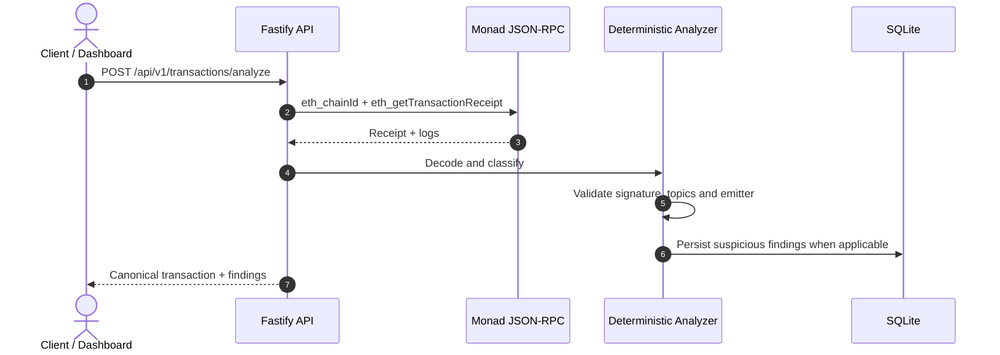
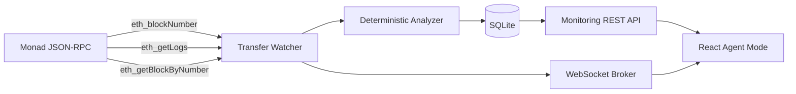

# GhostGuard

### Kanıt gelmeden güvenme.

[](https://docs.monad.xyz/developer-essentials/testnet)
[](https://nodejs.org/)
[](https://www.typescriptlang.org/)
[](LICENSE)

GhostGuard, Monad Testnet üzerindeki transaction receipt'lerini, event emitter adreslerini ve ERC-20 `Transfer` loglarını deterministik kanıtlarla denetleyen bir on-chain güvenlik izleme ve analiz platformudur.

Bir transaction başarılı olabilir ve `Transfer(address,address,uint256)` biçiminde bir event yayımlayabilir. Ancak event'i yayımlayan sözleşme, beklenen token sözleşmesi olmayabilir. GhostGuard bu ayrımı görünür hale getirir:

- **Gerçek transaction** ile **yanıltıcı token transfer iddiasını** birbirinden ayırır.
- Kullanıcı girdisine veya tahmine değil, RPC'den alınan receipt ve loglara dayanır.
- Kanıt yetersizse fraud iddiası üretmez; `NEEDS_REVIEW` döndürür.
- Agent Mode ile bir hesabın finalized incoming/outgoing aktivitesini SQLite'a kaydeder ve realtime olarak gösterir.

> [!IMPORTANT]
> Bu proje bir hackathon/MVP demonstrasyonudur. Public deployment ve demo sözleşmeleri vardır; ancak production seviyesinde multi-user ownership, authentication, quota ve kalıcı disk stratejisi henüz tamamlanmamıştır.

---


---


## İçindekiler

- [Öne çıkan yetenekler](#öne-çıkan-yetenekler)
- [Canlı demo ve kanıtlar](#canlı-demo-ve-kanıtlar)
- [Hızlı başlangıç](#hızlı-başlangıç)
- [Nasıl çalışır](#nasıl-çalışır)
- [Mimari](#mimari)
- [Agent Mode](#agent-mode)
- [Analiz sınıflandırmaları](#analiz-sınıflandırmaları)
- [Monorepo yapısı](#monorepo-yapısı)
- [API özeti](#api-özeti)
- [Konfigürasyon](#konfigürasyon)
- [Test ve doğrulama](#test-ve-doğrulama)
- [Deployment](#deployment)
- [Güvenlik ve sınırlar](#güvenlik-ve-sınırlar)
- [Bilinen sınırlamalar](#bilinen-sınırlamalar)
- [Katkı](#katkı)
- [Lisans](#lisans)

---

## Öne çıkan yetenekler

### Deterministik receipt analizi

`POST /api/v1/transactions/analyze` endpoint'i transaction receipt'ini RPC'den yeniden alır ve şu kanıtları değerlendirir:

1. Receipt var mı?
2. Transaction başarılı mı, revert mi?
3. Log `Transfer` signature'ına uyuyor mu?
4. `from`, `to` ve `amount` alanları decode edilebiliyor mu?
5. Log emitter adresi trusted token adresiyle eşleşiyor mu?
6. Event kontrollü event-only demo sözleşmesinden mi geliyor?

### Kalıcı Agent Mode

Try It ekranında bir public EVM account adresi izlenebilir:

- finalized ERC-20 `Transfer` logları
- aktivasyon sonrasındaki top-level native transferler
- top-level contract call'lar
- incoming, outgoing ve self yönleri
- SQLite üzerinde kalıcı activity geçmişi
- WebSocket realtime güncellemeleri
- bağlantı koptuğunda HTTP polling ile recovery

Agent Mode read-only'dir; private key istemez, wallet bağlantısı veya transaction signing gerektirmez.

### Kanıt odaklı görselleştirme

Evidence Inspector, activity akışını animasyonlu bir account graph olarak gösterir:

| Görsel durum | Anlam |
|---|---|
| Yeşil | Incoming aktivite |
| Sarı | Outgoing aktivite |
| Kırmızı | Backend tarafından deterministik olarak suspicious bulunan evidence |
| Mor | Kanıt yetersiz; manuel inceleme gerekli |

Direction ve trust verdict'i bilerek ayrı tutulur. Her outgoing işlem suspicious değildir; her incoming event de otomatik olarak güvenilir sayılmaz.

---

## Canlı demo ve kanıtlar

| Kaynak | Değer |
|---|---|
| Unified uygulama | [ghostguard-unified.onrender.com](https://ghostguard-unified.onrender.com) |
| Liveness | [`/health/live`](https://ghostguard-unified.onrender.com/health/live) |
| Chain ID | `10143` — Monad Testnet |
| Trusted DemoToken | [`0x21A48A0f107BaF3DC2eDA13e4aB6B7e624397639`](https://testnet.monadscan.com/address/0x21A48A0f107BaF3DC2eDA13e4aB6B7e624397639) |
| DemoEventOnly | [`0xa7836d1245593d16929a3Eea3Aa34461EF08F474`](https://testnet.monadscan.com/address/0xa7836d1245593d16929a3Eea3Aa34461EF08F474) |
| Gerçek transfer örneği | [`0x22b9eb3a...df57f6d1f`](https://testnet.monadscan.com/tx/0x22b9eb3a62f096515a44a319fc119ea4411c1fb3c2652915497ecd4df57f6d1f) |
| Event spoof örneği | [`0x321987f4...cbde07c4`](https://testnet.monadscan.com/tx/0x321987f432eefd92503aadd386a18d4c7df518653046cdb9e37b54e8cbde07c4) |

Public Render instance'ı free plan üzerinde çalıştığı için cold start, sleep ve ephemeral filesystem davranışları görülebilir. Canlı durum için `/health/live`; RPC erişimi için `/health` kullanılmalıdır.

---

## Hızlı başlangıç

### Gereksinimler

- Node.js `22+`
- npm `10+`
- Foundry — yalnızca Solidity sözleşmelerini test/deploy etmek için
- Monad Testnet erişimi — backend çalışırken RPC endpoint'i gereklidir

### Kurulum

```bash
git clone https://github.com/aposalik/ghostguard.git
cd ghostguard
npm install
cp .env.example backend/.env.local
```

`backend/.env.local` içinde en azından `MONAD_RPC_URL` değerini kontrol edin. Local frontend varsayılan olarak backend'e `http://localhost:3000` üzerinden bağlanır.

### Geliştirme sunucuları

İki terminal açın:

```bash
# Terminal 1 — Fastify API, watcher ve WebSocket
npm run dev:backend
```

```bash
# Terminal 2 — React/Vite dashboard
npm run dev:frontend
```

Ardından:

- Frontend: <http://localhost:5173>
- Try It: <http://localhost:5173/#/try-it>
- Backend health: <http://localhost:3000/health>
- Liveness: <http://localhost:3000/health/live>

> [!TIP]
> Port `5173` başka bir uygulama tarafından kullanılıyorsa Vite'ın terminalde yazdırdığı gerçek portu kullanın. Frontend'in `VITE_API_BASE_URL` değeri backend'e erişebilen bir origin olmalıdır.

### Unified production build

Fastify'ın frontend build'ini aynı origin üzerinden servis ettiği unified build:

```bash
npm run build:unified
npm start
```

---

## Nasıl çalışır

### 1. Receipt ve log analizi



### 2. Agent Mode ingestion



Watcher, findings ve activity stream'leri ayrı checkpoint'lerle ilerler:

- `transfer-findings:v2`: ERC-20 log backfill'i
- `account-transactions:v1`: account watch aktivasyonundan sonraki top-level transaction stream'i

Bu ayrım, yeni bir account izlenmeye başlandığında tüm historical blokların full transaction olarak yeniden taranmasını önler.

> [!NOTE]
> Internal contract transferleri henüz trace-capable RPC ile indekslenmez. Watcher, log tabanlı token aktivitelerini ve top-level transaction'ları kapsar.

---

## Mimari

GhostGuard üç ana çalışma alanından oluşur:

```text
ghostguard/
├── frontend/       React 19 + Vite dashboard
├── backend/        Fastify API + RPC watcher + SQLite
├── shared/         Frontend/backend arasında ortak TypeScript tipleri
└── contracts/      Foundry demo sözleşmeleri ve testleri
```

### Frontend — presentation ve recovery

- `TryItPage`: account monitoring workbench'i
- `useAccountMonitor`: watch toggle, activity history, WebSocket reconnect ve polling recovery
- `EvidenceGraphPanel`: account graph ve kanıt durumları
- `AccountActivityList`: SQLite'dan gelen kalıcı transaction/activity ledger
- `services/api.ts`: typed REST ve WebSocket client

Frontend security verdict üretmez. Backend erişilemezse boş veya stale veriyi canlıymış gibi göstermez.

### Backend — source of truth

- `TransactionAnalyzer`: receipt ve emitter doğrulaması
- `TransferWatcher`: finalized block polling, account watch loading ve activity üretimi
- `SqliteFindingStore`: watch, activity, finding ve checkpoint persistence
- Fastify API: analysis, findings, monitoring ve operational status endpoint'leri
- WebSocket broker: `finding.created` ve `activity.created` event'leri
- Opsiyonel Resend notifier: suspicious/review finding alert queue'su

### Shared — contract boundary

`shared/types/index.ts`, frontend ve backend'in aynı domain modelini kullanmasını sağlar:

- `SecurityFinding`
- `MonitoredAccount`
- `AccountActivity`
- `AccountActivitiesPage`
- analyzer ve agent status response tipleri

### Contracts — kontrollü demonstrasyon

- `DemoToken.sol`: gerçek balance mutation yapan minimal ERC-20
- `DemoEventOnly.sol`: token balance tutmadan `Transfer` biçimli event yayımlayan owner-only demo sözleşmesi
- `DemoContracts.t.sol`: gerçek balance transferi ile event-only iddiasını ayıran Foundry testleri

---

## Agent Mode

Try It ekranında account adresini elle girebilir veya ileride eklenecek wallet-connect UX'iyle public adresi doldurabilirsiniz. Mevcut Agent Mode, read-only HTTP API kullanır; MetaMask imzası istemez.

```http
GET /api/v1/monitoring/accounts
PUT /api/v1/monitoring/accounts/:address
GET /api/v1/monitoring/accounts/:address/activities?limit=100&cursor=<opaque>
WS  /api/v1/events
```

Toggle request body:

```json
{ "enabled": true }
```

`enabled: false` gelecekteki indexing'i durdurur; geçmiş activity satırlarını silmez.

Activity modeli:

| Alan | Değerler |
|---|---|
| `direction` | `INCOMING`, `OUTGOING`, `SELF` |
| `kind` | `NATIVE_TRANSFER`, `CONTRACT_CALL`, `TOKEN_TRANSFER` |
| `verdict` | `CONFIRMED`, `SUSPICIOUS`, `NEEDS_REVIEW`, `REVERTED` |

Bir on-chain transaction'ın gerçek olması, içindeki token transfer iddiasının doğru olduğu anlamına gelmez. GhostGuard'ın kırmızı verdict'i transaction'ı “sahte blockchain işlemi” ilan etmez; deceptive evidence bulunduğunu belirtir.

---

## Analiz sınıflandırmaları

| Classification | Anlam | Kanıt |
|---|---|---|
| `VERIFIED_DEMO_TRANSFER` | Trusted DemoToken tarafından yayımlanan doğrulanmış Transfer | Başarılı receipt, doğru topic'ler ve allowlisted emitter |
| `SUSPICIOUS_EVENT` | Transfer biçimli fakat trusted token dışı event | Başarılı receipt, decoded claim ve emitter mismatch |
| `NEEDS_REVIEW` | Kanıt yetersiz veya emitter bilinmiyor | Unknown emitter, eksik log veya tamamlanamayan decode |
| `FAILED_TRANSACTION` / `REVERTED` | On-chain execution revert olmuş | Receipt status `0` |
| `PENDING` | Receipt henüz bulunamadı veya finalize olmadı | RPC'de tamamlanmış receipt yok |
| `CONFIRMED` | Account activity için güvenilir, normal gözlem | Activity türü ve receipt gözlemi tutarlı |

`TOKEN_STATE_SUPPORTS_CLAIM` balance-delta kontrolü henüz uygulanmadığı sürece bilinçli olarak `UNKNOWN` kalabilir. Bilinmeyen kanıt otomatik olarak fraud sayılmaz.

---

## API özeti

### Health

```http
GET /health
GET /health/live
```

- `/health`: RPC bağlantısı ve chain ID kontrolü; sağlıklıysa `200`, degraded ise `503`
- `/health/live`: process liveness; RPC'den bağımsız `200`

### Transaction analysis

```http
POST /api/v1/transactions/analyze
Content-Type: application/json
```

```json
{
  "transactionHash": "0x<64 hex karakter>",
  "expectedTokenAddress": "0x<40 hex karakter>"
}
```

`expectedTokenAddress` opsiyoneldir ve server-side trusted allowlist'i geçersiz kılmaz.

### Findings ve status

```http
GET /api/v1/findings?limit=20&cursor=<opaque>
GET /api/v1/agents/status
```

### Realtime events

```text
ws://localhost:3000/api/v1/events
```

Mesaj türleri:

- `finding.created`
- `activity.created`

Tam sözleşme için [`docs/API_CONTRACT.md`](docs/API_CONTRACT.md) dosyasına bakın.

---

## Konfigürasyon

`.env.example` dosyası başlangıç şablonudur. Secret değerlerini `.env.local`, host secret store veya deployment provider üzerinden sağlayın; Git'e yazmayın.

| Değişken | Gerekli | Açıklama |
|---|---:|---|
| `MONAD_RPC_URL` | Evet | Monad JSON-RPC HTTP endpoint'i |
| `TRUSTED_DEMO_TOKEN_ADDRESS` | Hayır | Verified demo emitter allowlist'i |
| `DEMO_EVENT_ONLY_ADDRESS` | Hayır | Kontrollü event-only demo emitter'i |
| `HOST` / `PORT` | Hayır | Fastify bind ayarları; varsayılan `0.0.0.0:3000` |
| `CORS_ORIGINS` | Hayır | Virgülle ayrılmış frontend origin listesi |
| `DATABASE_URL` | Hayır | SQLite dosya yolu |
| `WATCH_ENABLED` | Hayır | Watcher için `true` |
| `MONITORED_WALLET_ADDRESSES` | Hayır | Environment seed account listesi |
| `WATCH_CONFIRMATIONS` | Hayır | Finality confirmation sayısı; varsayılan `5` |
| `WATCH_BLOCK_RANGE` | Hayır | Tek RPC log sorgusunun block aralığı |
| `WATCH_POLL_INTERVAL_MS` | Hayır | Watcher poll aralığı |
| `WATCH_START_BLOCK` | Hayır | ERC-20 finding backfill başlangıcı |
| `EMAIL_ENABLED` | Hayır | Resend alert queue'su |
| `EMAIL_API_KEY` | Email açıksa | Secret; hiçbir zaman commit edilmemeli |
| `ALERT_EMAIL_FROM` / `ALERT_EMAIL_TO` | Email açıksa | Alert sender/recipient |
| `PRODUCER_ENABLED` | Hayır | Demo transaction producer; varsayılan kapalı |
| `PRODUCER_PRIVATE_KEY` | Producer açıksa | Yalnızca güvenli host secret olarak sağlanmalı |

### RPC proxy notu

Bazı geliştirme ortamlarında sistem HTTP proxy'sinin TLS sertifikası Monad endpoint'iyle uyumsuz olabilir. Böyle bir ortamda terminal process'i için yalnızca Monad RPC host'unu proxy dışında bırakın:

```bash
export NO_PROXY=testnet-rpc.monad.xyz
export no_proxy=testnet-rpc.monad.xyz
```

TLS doğrulamasını genel olarak kapatmayın ve production'da `--insecure` kullanmayın.

---

## Test ve doğrulama

Tüm JavaScript/TypeScript workspaces için:

```bash
npm run lint
npm run typecheck
npm test
npm run build
```

Tek komut kalite kapısı:

```bash
npm run check
```

Foundry sözleşmeleri için:

```bash
forge test --root contracts -vvv
```

Frontend ve backend testleri sırasıyla `frontend/src/**/*.test.ts` ve `backend/src/**/*.test.ts` altında bulunur. Testler deterministic analyzer, RPC validation, SQLite persistence, monitoring API, watcher behavior ve graph mapping'i kapsar.

---

## Deployment

### Unified Render service

`render.yaml`, frontend ve backend'i tek Node web service olarak deploy etmek için blueprint sağlar:

```text
npm ci && npm run build:unified
npm start
```

Fastify production build mevcutsa:

- `/` → React dashboard
- `/health` ve `/health/live` → health endpoints
- `/api` → service metadata
- `/api/v1/*` → REST API
- `/api/v1/events` → WebSocket

Render free plan'de `DATABASE_URL=/tmp/ghostguard.db` kullanıldığı için restart/spin-down sonrası SQLite geçmişi kalıcı olmayabilir. Kalıcı monitoring için persistent volume veya harici database gerekir.

### Frontend-only deployment

Vercel ve Netlify konfigürasyonları frontend build'i içindir. Frontend-only deployment'da `VITE_API_BASE_URL`, erişilebilir bir GhostGuard backend URL'sine ayarlanmalıdır. Backend olmadan dashboard transaction veya activity sonucu uydurmaz.

---

## Güvenlik ve sınırlar

- GhostGuard private key, seed phrase veya MetaMask signing istemez; Agent Mode read-only'dir.
- Backend kararları RPC receipt ve log verisini yeniden okuyarak üretir.
- Browser tarafından gönderilen `expectedTokenAddress`, trusted server-side allowlist'i değiştiremez.
- API status response'ları private key, RPC credential veya email credential içermez.
- Event-only demo sözleşmesi owner-only'dir ve yalnızca kontrollü testnet demonstrasyonu içindir.
- `PRODUCER_ENABLED` varsayılan olarak kapalıdır; açılması gerçek transaction ve gas maliyeti doğurabilir.
- RPC, explorer ve external email provider dış sistemlerdir; availability garanti edilmez.
- Public multi-user kullanım için account ownership, authentication, rate limit ve quota henüz eklenmemiştir.

---

## Bilinen sınırlamalar

1. Internal transaction traces henüz indekslenmez.
2. Token balance-delta kanıtı tüm tokenlar için uygulanmış değildir; ilgili check `UNKNOWN` olabilir.
3. SQLite store tek instance/local persistence varsayımına dayanır.
4. Public watchlist endpoint'leri production multi-user isolation için authentication bekler.
5. Monad RPC rate limitleri ve transient network errors watcher gecikmesine neden olabilir.
6. MetaMask bağlantısı Agent Mode için gerekli değildir; public address manuel olarak girilebilir.

---

## İlgili dokümantasyon

- [`docs/API_CONTRACT.md`](docs/API_CONTRACT.md) — REST ve WebSocket sözleşmesi
- [`docs/ARCHITECTURE.md`](docs/ARCHITECTURE.md) — backend pipeline ve deployment topolojisi
- [`docs/DEMO.md`](docs/DEMO.md) — 90 saniyelik hackathon demo akışı
- [`docs/STATUS.md`](docs/STATUS.md) — doğrulama ve implementation durumu
- [`docs/HANDOFF.md`](docs/HANDOFF.md) — teknik handoff ve sonraki işler
- [`backend/README.md`](backend/README.md) — backend-specific config ve operasyon notları
- [`frontend/README.md`](frontend/README.md) — frontend-specific development notları
- [`contracts/README.md`](contracts/README.md) — Foundry workspace

---

## Katkı

1. Branch oluşturun.
2. Değişikliği küçük ve doğrulanabilir tutun.
3. `npm run check` ve ilgili Foundry testlerini çalıştırın.
4. API/model değişikliklerinde `shared/types`, `docs/API_CONTRACT.md` ve ilgili testleri birlikte güncelleyin.
5. Secret, private key, seed phrase veya gerçek credential commit etmeyin.

---

## Ekip

Monad Blitz Ankara hackathon çalışması:

- **Fahad Faisal** — frontend engineering, UX architecture, responsive design, Agent Mode graph ve client integration
- **Abdullah Salik** — backend architecture, RPC watcher, deterministic analyzer, SQLite persistence, Foundry contracts ve on-chain deployment

---

## Lisans

Bu proje [MIT License](LICENSE) altında yayımlanmıştır.
