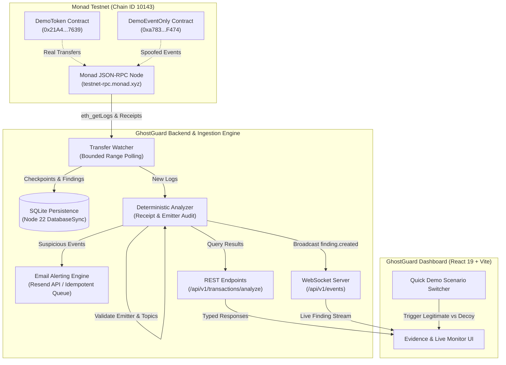
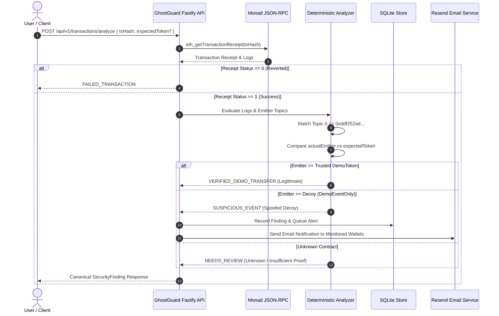

# GhostGuard 🛡️
### Real-Time ERC-20 Event Spoofing Detection & Proof-Grounded Verification Engine for Monad

[](https://testnet.monadscan.com)
[](https://ghostguard-unified.onrender.com)
[](LICENSE)
[](contracts/)
[](shared/)

GhostGuard is an on-chain security monitoring tool and deterministic transaction analyzer built for the **Monad Blitz Ankara (October 2026)** hackathon. It detects and explains **ERC-20 Event Spoofing** and deceptive transfer claims by auditing transaction receipts, log emitters, and token contracts against verifiable blockchain state.

---

## 🌐 Live Deployments & Testnet Proofs

| Resource | Value / Link | Description |
|---|---|---|
| **Live Unified App** | [ghostguard-unified.onrender.com](https://ghostguard-unified.onrender.com) | Production React Dashboard & Unified Fastify Service |
| **API Health Check** | [/health/live](https://ghostguard-unified.onrender.com/health/live) | Liveness Probe (`status: "ok"`) |
| **Monad Chain ID** | `10143` | Official Monad Testnet |
| **Honest DemoToken (`GGD`)** | [`0x21A48A0f107BaF3DC2eDA13e4aB6B7e624397639`](https://testnet.monadscan.com/address/0x21A48A0f107BaF3DC2eDA13e4aB6B7e624397639) | Standard ERC-20 with real balance mutations |
| **Decoy DemoEventOnly** | [`0xa7836d1245593d16929a3Eea3Aa34461EF08F474`](https://testnet.monadscan.com/address/0xa7836d1245593d16929a3Eea3Aa34461EF08F474) | Decoy contract emitting transfer events with 0 balance mutation |
| **Legitimate Transfer Tx** | [`0x22b9eb3a...df57f6d1f`](https://testnet.monadscan.com/tx/0x22b9eb3a62f096515a44a319fc119ea4411c1fb3c2652915497ecd4df57f6d1f) | Verified transfer: recipient received 25 GGD (`VERIFIED_DEMO_TRANSFER`) |
| **Spoofed Decoy Event Tx** | [`0x321987f4...cbde07c4`](https://testnet.monadscan.com/tx/0x321987f432eefd92503aadd386a18d4c7df518653046cdb9e37b54e8cbde07c4) | Spoofed transfer: receipt success, emitter mismatch, 0 tokens moved (`SUSPICIOUS_EVENT`) |

---

## 🎯 The Core Problem: The "Successful Receipt" Illusion

In Web3, wallets (like MetaMask or Rabby) and block explorers announce token transfers by indexing standard ERC-20 `Transfer(address,address,uint256)` event signatures (`0xddf252ad1be2c89b69c2b068fc378daa952ba7f163c4a11628f55a4df523b3ef`).

> [!CAUTION]
> **Any smart contract on EVM can emit that exact same `Transfer` event.**
> An attacker or decoy contract can emit `Transfer(Alice, Bob, 1000 GGD)` without holding any tokens or changing any balances.
>
> * **Transaction Status:** `SUCCESS (1)` ✅
> * **Explorer / Wallet Notification:** *"You received 1,000 GGD from 0x..."* 🔔
> * **Actual Token Balance Transferred:** **$0.00 (Zero tokens moved!)** ❌

This deceptive technique is the foundational mechanism behind **address-poisoning scams**, fake payment receipts, and false-transfer fraud. **GhostGuard exists to expose this illusion.**

---

## 🏗️ System Architecture & Data Flow

GhostGuard implements a decoupled, event-driven security pipeline spanning from on-chain RPC ingestion to client-side real-time monitoring:



---

## 🔬 Transaction Verification Pipeline

When a transaction is analyzed, GhostGuard executes a deterministic verification lifecycle without relying on probabilistic machine learning or hallucinating models:



---

## 📊 Classification Taxonomy

GhostGuard classifies events into clear, proof-grounded security states:

| Classification | Meaning | On-Chain Evidence Required |
|---|---|---|
| 🟢 **`VERIFIED_DEMO_TRANSFER`** | Legitimate Token Transfer | Receipt `SUCCESS`, `log.address == trustedTokenAddress`, and transfer topics correctly decoded. |
| 🔴 **`SUSPICIOUS_EVENT`** | Event Spoofing / Decoy | Receipt `SUCCESS`, but `log.address != trustedTokenAddress`. Emitted by a third-party contract without moving token balances. |
| 🟡 **`NEEDS_REVIEW`** | Inconclusive Evidence | Unknown emitter, partial receipt, or unallowlisted contract. Avoids false-positive accusations. |
| ⚪ **`FAILED_TRANSACTION`** | Reverted Execution | Receipt `STATUS == 0`. Execution reverted on-chain. |
| 🔵 **`PENDING`** | Mempool / Unconfirmed | Transaction has not been finalized into a block receipt yet. |

---

## 📂 Monorepo Structure

```text
ghostguard/
├── contracts/                # Foundry smart contract workspace
│   ├── src/
│   │   ├── DemoToken.sol     # Minimal ERC-20 with real balance mutations
│   │   └── DemoEventOnly.sol # Decoy contract emitting transfer events
│   ├── test/
│   │   └── DemoContracts.t.sol # Formal proofs of balance vs event separation
│   ├── script/
│   │   └── DeployAndSeed.s.sol # Monad Testnet deployment & seeding script
│   └── foundry.toml          # Solidity 0.8.28 compiler & optimizer config
├── backend/                  # Fastify & Ingestion engine
│   ├── src/
│   │   ├── analyzer/         # Pure deterministic receipt & emitter analyzer
│   │   ├── api/              # Fastify REST endpoints, error mapping & CORS
│   │   ├── watcher/          # Monad RPC log scanner, SQLite store & Resend email
│   │   ├── config/           # Strictly typed environment configuration
│   │   └── server.ts         # Unified server entrypoint
│   └── tsconfig.json
├── frontend/                 # React 19 + TypeScript dashboard
│   ├── src/
│   │   ├── components/       # Evidence panels, search, presets & live monitors
│   │   ├── hooks/            # Analysis state machines & polling
│   │   ├── services/         # Typed HTTP & WebSocket client
│   │   └── pages/            # Dashboard main page
│   └── vite.config.ts
├── shared/                   # Shared TypeScript domain models & API contracts
│   └── types/index.ts        # Canonical SecurityFinding, Request & Response types
├── docs/                     # Engineering documentation suite
│   ├── ARCHITECTURE.md       # Pipeline architecture & system design
│   ├── API_CONTRACT.md       # REST & WebSocket specifications
│   ├── DEMO.md               # 90-second judge demo runbook & hashes
│   ├── PLAN.md               # Phased roadmap & team ownership
│   └── STATUS.md             # Verification logs & on-chain audit trail
└── render.yaml               # Infrastructure-as-code deployment blueprint
```

---

## 🛠️ Local Development & Quickstart

### Prerequisites
* **Node.js**: `v22.2.0+` (Required for native `node:sqlite` support)
* **npm**: `v10+`
* **Foundry**: `forge 1.8.6+` (For smart contract testing and deployment)

### 1. Installation
```bash
git clone https://github.com/aposalik/ghostguard.git
cd ghostguard
npm install
```

### 2. Configure Environment
```bash
cp .env.example backend/.env.local
```
Configure your local environment variables in `backend/.env.local`:
```env
MONAD_RPC_URL=https://testnet-rpc.monad.xyz
TRUSTED_DEMO_TOKEN_ADDRESS=0x21A48A0f107BaF3DC2eDA13e4aB6B7e624397639
DEMO_EVENT_ONLY_ADDRESS=0xa7836d1245593d16929a3Eea3Aa34461EF08F474
PORT=3000
```

### 3. Run Smart Contract Tests (Foundry)
```bash
forge test --root contracts -vvv
```
Output:
```text
[PASS] testEventOnlyEmitsTransferShapeWithoutChangingTokenBalances()
[PASS] testEventOnlyRejectsNonOwner()
[PASS] testRealTransferChangesBalancesAndEmitsFromToken()
Suite result: ok. 3 passed; 0 failed; 0 skipped
```

### 4. Run Verification Suite
Run linting, type-checking, unit tests, and builds across all workspaces:
```bash
npm run check
```

### 5. Start Development Servers
```bash
# Terminal 1: Start Backend API & Watcher
npm run dev:backend

# Terminal 2: Start Frontend Dashboard
npm run dev:frontend
```
Open [http://localhost:5173](http://localhost:5173) in your browser.

---

## 📡 API Contract (v1)

### `POST /api/v1/transactions/analyze`
Analyzes an on-chain transaction receipt against expected token contracts.

#### Request:
```json
{
  "transactionHash": "0x22b9eb3a62f096515a44a319fc119ea4411c1fb3c2652915497ecd4df57f6d1f",
  "expectedTokenAddress": "0x21A48A0f107BaF3DC2eDA13e4aB6B7e624397639"
}
```

#### Response (200 OK):
```json
{
  "transaction": {
    "chainId": 10143,
    "transactionHash": "0x22b9eb3a62f096515a44a319fc119ea4411c1fb3c2652915497ecd4df57f6d1f",
    "receiptStatus": "SUCCESS",
    "blockNumber": "73787270"
  },
  "findings": [
    {
      "id": "10143:0x22b9eb3a...df57f6d1f:0",
      "chainId": 10143,
      "transactionHash": "0x22b9eb3a...df57f6d1f",
      "logIndex": 0,
      "blockNumber": "73787270",
      "classification": "VERIFIED_DEMO_TRANSFER",
      "actualEmitterAddress": "0x21A48A0f107BaF3DC2eDA13e4aB6B7e624397639",
      "expectedTokenAddress": "0x21A48A0f107BaF3DC2eDA13e4aB6B7e624397639",
      "claimedTransfer": {
        "from": "0x72a319E6ff8A30A8a524C8559DF185164409b9BD",
        "to": "0x07eeAf6BB355fa538eb69Df7A3Fdd6C81E3807fB",
        "amount": "25000000000000000000"
      },
      "explanation": "Event emitted directly by the trusted demo token contract. Receipt status is SUCCESS.",
      "analyzedAt": "2026-10-24T12:00:00.000Z"
    }
  ]
}
```

---

## 👥 Team & Ownership

Built during **Monad Blitz Ankara (24 October 2026)**:

* **Developer A — Fahad ([@MFahadFaisal](https://github.com/MFahadFaisal)):** Frontend Engineering, UX Architecture, Responsive Design, Preset Scenarios, and Client Integration.
* **Developer B — Abdullah Salik ([@aposalik](https://github.com/aposalik)):** Backend Architecture, RPC Watcher, Foundry Smart Contracts, Deterministic Analyzer, SQLite Persistence, and On-Chain Deployment.

---

## 📜 Security Policy & Disclaimer

* **Hackathon Demonstration Scope:** GhostGuard is built to highlight and prove deceptive event spoofing and receipt misconceptions. It is an MVP engineered for educational demonstration and on-chain verification.
* **Deterministic Guardrails:** GhostGuard never hallucinates findings; every classification maps strictly to verifiable receipt status, decoded log topics, and emitter contract addresses.
* **Confidentiality:** Private keys, seed phrases, and operational secrets are strictly excluded from code, documentation, and version control.

---

## 📄 License

This project is licensed under the [MIT License](LICENSE).
